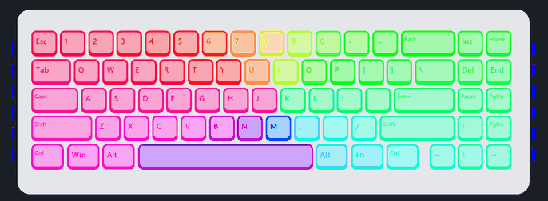
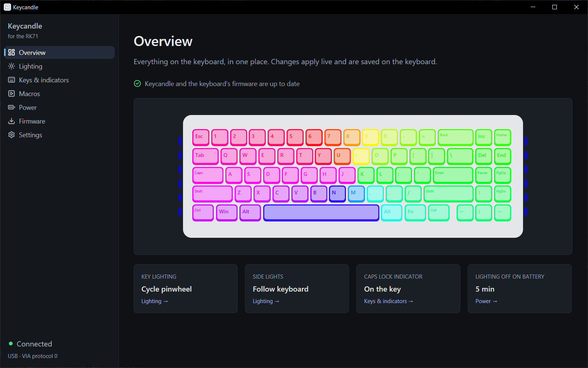
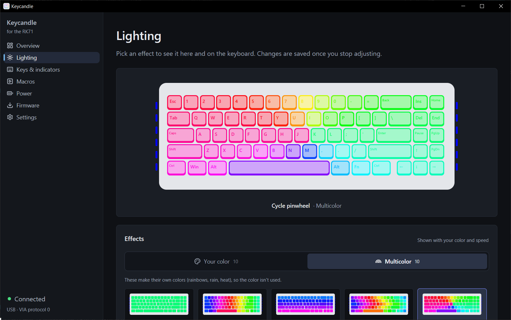
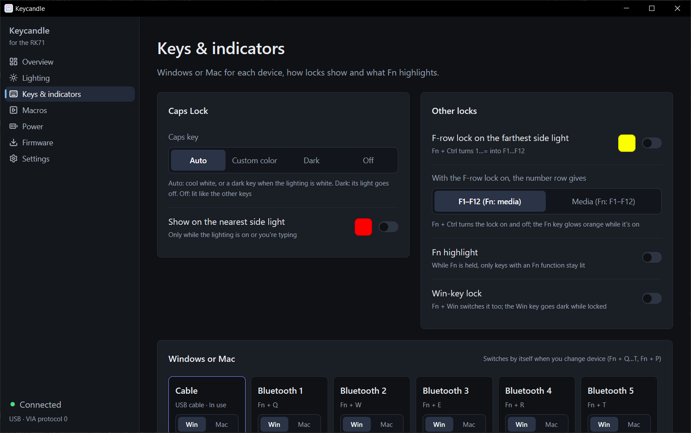
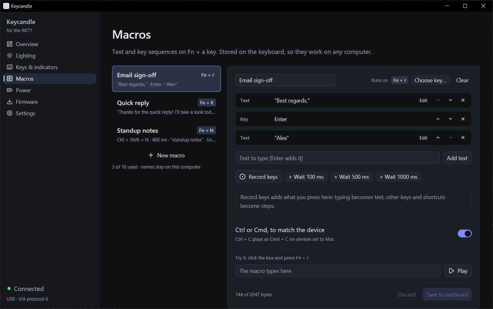
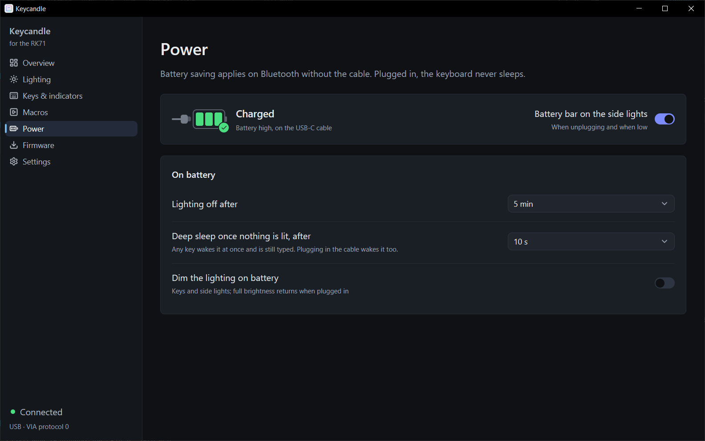
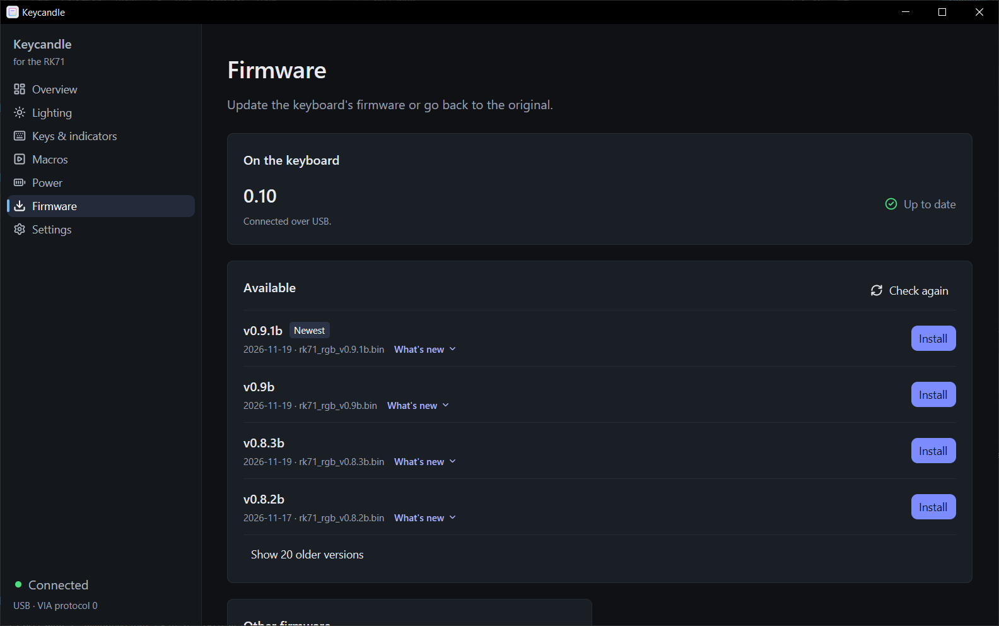
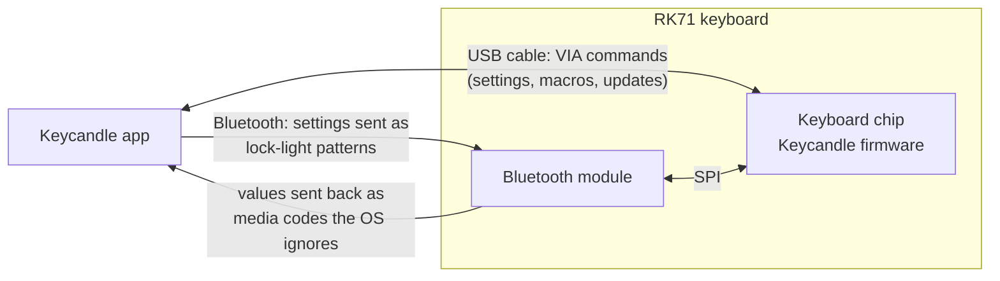

  

<h1 align="center">Keycandle</h1>

  <b>New firmware and a desktop app for the Royal Kludge RK71 RGB.</b> 
  Smoother lighting, settings over Bluetooth, macros on any key, and a battery you can see.

  
  
  
  

  

  <a href="../../releases/latest"><b>Download</b></a> ·
  <a href="https://josemanuque.github.io/keycandle/"><b>Website</b></a> ·
  <a href="docs/USER_GUIDE.md"><b>User guide</b></a> ·
  <a href="CHANGELOG.md"><b>What's new</b></a>

---

The RK71 is a great little 70% keyboard held back by its factory firmware. It's closed, it only
configures from a Windows app, and over Bluetooth you can't change anything. **Keycandle replaces the
firmware with an open one built on [QMK](https://qmk.fm)** and fully compatible with [VIA](https://usevia.app).
It also comes with a desktop app that shows the keyboard live and changes every setting, over the cable or
over Bluetooth. The app is native, written in [Rust](https://www.rust-lang.org) with
[GPUI](https://www.gpui.rs) (the GPU-accelerated UI framework behind the Zed editor), so it starts instantly and
stays light.

Installing takes a minute from the app. The original firmware is always one click away.

## Highlights

<table>
<tr>
<td width="50%" valign="top">

### ✨ Lighting without flicker
Keys refresh about **1,400 times a second** and the side lights about **3,100**, measured on the board (QMK's
own driver for this chip managed 165). That's above the IEEE 1789 levels where flicker stops being visible, so colours no longer split
apart when your eyes move. You get 20 effects and live previews in the app.

</td>
<td width="50%" valign="top">

### 📶 Settings over Bluetooth, both ways
Change lighting, Windows/Mac and more with the cable unplugged. Changes you make with the Fn keys show up
in the app, along with the device in use and the battery. Bluetooth keyboards normally have no channel
for any of this; the [protocol](docs/BLUETOOTH.md#settings-over-bluetooth) explains the trick.

</td>
</tr>
<tr>
<td valign="top">

### ⌨️ Macros on Fn + any key
Up to 16 macros: text, keys, shortcuts and pauses. Record them by typing, test them in the app, and they run
from the keyboard itself, so they work on any computer. **Ctrl ↔ Cmd** swaps by itself on devices set to Mac.

</td>
<td valign="top">

### 🖥️ Windows or Mac, per device
Each of the 5 Bluetooth devices and the cable remembers its own layout. A Mac and a PC can share the
keyboard and each gets the right modifier keys, with no switching by hand.

</td>
</tr>
<tr>
<td valign="top">

### 🔋 Battery you can see
The Power page shows the battery level, whether it's charging, and the cable. The keyboard deep-sleeps
when idle, and **the key that wakes it is still typed**.

</td>
<td valign="top">

### 🛟 Safe updates
The app installs new versions over the cable. It checks the file and puts your settings and macros back
afterwards. Going back to the original firmware is a button, and recovery is documented step by step.

</td>
</tr>
<tr>
<td valign="top">

### 🧩 VIA compatible
Works with [VIA](https://usevia.app) in Chrome or Edge, with nothing to install. Remap any key on all 5 layers,
edit macros, and reach every Keycandle setting in VIA's menus. The VIA definition,
[`rk71_rgb_via.json`](via/rk71_rgb_via.json), comes with every release.

</td>
<td valign="top">

### 🔬 Reverse-engineered, then improved
Every pin, the key matrix, the LEDs and the Bluetooth module's protocol were worked out by disassembling the
original firmware. Keycandle keeps everything the factory firmware did, then does it better.
[How](#built-from-the-original-firmware).

</td>
</tr>
</table>

## A look at the app

| | |
|:---:|:---:|
|  **Overview:** the keyboard as it is now, and what's set |  **Lighting:** pick an effect from a gallery of live previews |
|  **Keys & indicators:** Caps Lock, F-row lock, Win/Mac per device |  **Macros:** write, record and try them |
|  **Power:** battery, charging, sleep times |  **Firmware:** one-click updates, or back to the original |

The app is in English, Spanish and Portuguese, follows the system's light or dark theme, and on macOS has the
translucent sidebar and a full menu bar.

## Get started

1. **Download the app** for your computer from the [latest release](../../releases/latest):
   * Windows: `keycandle-windows-x64.exe` (nothing to install, just run it)
   * macOS (Apple Silicon and Intel): `keycandle-macos-universal.zip`
   * Linux: `keycandle-linux-x64.tar.gz` (see its README.txt for USB access)
2. **Plug the keyboard in with the USB cable.** The app finds it, even on the original firmware.
3. Open **Firmware** and click **Install**. The keyboard restarts on its own; about a minute later you're set.

After that, use the app over the cable or Bluetooth, or [VIA](#via) in the browser with the provided JSON.

> [!NOTE]
> **macOS, the first time:** the app isn't notarized by Apple. If macOS says it can't check it, open
> **System Settings ▸ Privacy & Security** and click **Open Anyway**. For settings over Bluetooth, allow it under
> **Input Monitoring** when asked.

## How it works

* **Over the cable**, the app talks to the firmware the way [VIA](https://usevia.app) does. It reads and
  writes settings, macros and keys, and installs updates.
* **Over Bluetooth**, the module gives the computer only a keyboard and media keys, with no data channel. So
  the app spells each setting out by flipping the keyboard's Num, Caps and Scroll lock lights in a pattern
  (the real lock states don't change). The keyboard decodes the pattern, confirms it, and sends its own
  values back as media-key codes that no operating system acts on. Reconnecting takes about 1.3 seconds
  (the app sends a checksum of what it already knows, so unchanged values aren't sent again), and typing is
  never blocked. [Details](docs/BLUETOOTH.md#settings-over-bluetooth).
* **The app** is written in Rust with [GPUI](https://www.gpui.rs) and
  [gpui-component](https://github.com/longbridge/gpui-component): one native binary per system, rendered on the
  GPU, with no browser engine inside. It talks to the keyboard through hidapi, and its live previews run the same
  effect formulas as the firmware.
* **The firmware** is a QMK port written for this exact board. Every pin and the Bluetooth module's protocol
  were worked out by disassembling the factory firmware, not guessed. It has its own key-LED driver (for the
  refresh rate), a Bluetooth driver, a side-light driver, deep sleep, and macros stored in their own flash.

## Built from the original firmware

There was no documentation, schematic or source for this board, so Keycandle started from the factory firmware
itself. The V1.12 image was disassembled to learn:

* **The hardware map:**
  * which chip pins scan the key matrix and drive the per-key and side LEDs;
  * where the cable is sensed;
  * how the board enters its bootloader.
* **The Bluetooth module:**
  * its SPI link and packet format (it turned out to speak the same protocol as QMK's ITON driver);
  * the commands for devices, pairing and battery;
  * the events it sends back ([details](docs/BLUETOOTH.md)).
* **The factory behaviour:** the Fn shortcuts, device switching and pairing holds, status lights, battery
  warnings and sleep. Keycandle reproduces all of it, so nothing you relied on is lost.

Then it improved on what it found:
* a key-LED driver about 9 times faster than QMK's own for this chip;
* side lights that mix real colours;
* deep sleep that doesn't swallow the waking key;
* per-device Windows/Mac;
* macros;
* settings over Bluetooth.

The original firmware and Royal Kludge's tools are preserved in [`stock/`](stock/README.md), with the notes from
the disassembly ([FIRMWARE_NOTES.md](stock/FIRMWARE_NOTES.md)), so the keyboard can always go back.

## VIA

Keycandle speaks VIA's protocol, so [usevia.app](https://usevia.app) configures it directly. VIA doesn't know this
board on its own, so load its definition once:

1. Download `rk71_rgb_via.json` from the [latest release](../../releases/latest) (also in [`via/`](via/rk71_rgb_via.json)).
2. In VIA, turn on **Settings ▸ Show Design tab**, then load the file under **Design**.
3. **Authorize device** and pick the RK71, with the cable plugged in.

VIA's menus have every Keycandle setting:
* side lights, effects and calibration;
* Caps Lock and F-row lock indicators;
* Windows or Mac per device;
* power and sleep times.

On top of that you get VIA's own keymap editor for all 5 layers and its macro editor, which shares macros with the
app. The Bluetooth keys are under *Special ▸ Custom*.

## The firmware

| | Factory firmware | Keycandle |
|---|---|---|
| Source code | Closed | Open, GPL-2.0 ([`keyboard/rk71_rgb`](keyboard/rk71_rgb)) |
| Configure from | Royal Kludge's Windows app | The Keycandle app (Windows, macOS, Linux), or [VIA](#via) with the provided JSON |
| …over Bluetooth | No | Yes, both ways |
| Light refresh | Not published | Keys ~1,400 Hz, side lights ~3,100 Hz, measured on the board |
| Side lights | Status only | Follow the keys or a fixed colour, 5 effects, Caps Lock and F-row lock indicators, calibration |
| Remapping | What the vendor app allows | Every key on all 5 layers, any QMK keycode |
| Macros | – | 16, on Fn + any free key, Ctrl/Cmd matched to the device |
| Windows/Mac | One switch | Remembered per Bluetooth device and for the cable |
| Battery | – | High / medium / low, charging, in the app and on the side lights (Fn+Space) |
| Sleep | Deep sleep | Deep sleep, instant wake, the waking key is typed; times are adjustable |
| Switch chatter | Vendor default | 10 ms debounce per key |

Everything about the keys, Fn shortcuts, lights and status colours is in the **[user guide](docs/USER_GUIDE.md)**.

## Compatibility

* **Keyboard:** Royal Kludge **RK71 RGB**, the tri-mode version with Bluetooth. PCB `603-836/RGB-BT-HFD REV:01`,
  chip SONiX SN32F248BF. [How to check yours](docs/USER_GUIDE.md#is-my-keyboard-supported).
* **App:** Windows 10 and 11, macOS 11 or later (universal), Linux x64. Settings over Bluetooth work on all three.
* **Firmware updates** need the USB cable: the chip's bootloader is USB-only.

## Good to know

* The Bluetooth module reports the battery only as high, medium or low, and the board has no wire to measure
  it, so there's no percentage.
* The side lights' mixed colours are approximate. Each light mixes red, green and blue very quickly, and the
  diffuser is bluish. They can be calibrated per light.
* Installing new firmware resets the keyboard's stored settings. The app puts back your settings and macros
  afterwards; VIA keymap changes aren't restored.

## More

* [User guide](docs/USER_GUIDE.md): keys, Fn shortcuts, Bluetooth, lighting, status lights, VIA, troubleshooting
* [Changelog](CHANGELOG.md): every version
* [Bluetooth](docs/BLUETOOTH.md): the module's protocol and how settings travel over Bluetooth
* [Development](docs/DEVELOPMENT.md): building the firmware and app, project layout, releases, hardware IDs
* [Original firmware](stock/README.md): the factory firmware, preserved, plus going back and unbricking

## License

The firmware, app and tools are GPL-2.0-or-later ([LICENSE](LICENSE)), like QMK. Keycandle is an independent
project, not affiliated with or endorsed by Royal Kludge. Royal Kludge's firmware and programs (in `stock/` and
on the [`stock-v1.12`](../../releases/tag/stock-v1.12) release) are their property. They're mirrored only so
owners of this keyboard can always go back, and they aren't covered by this license.
